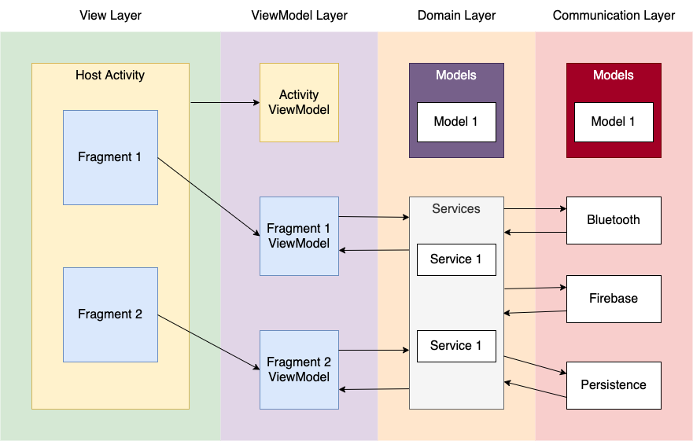
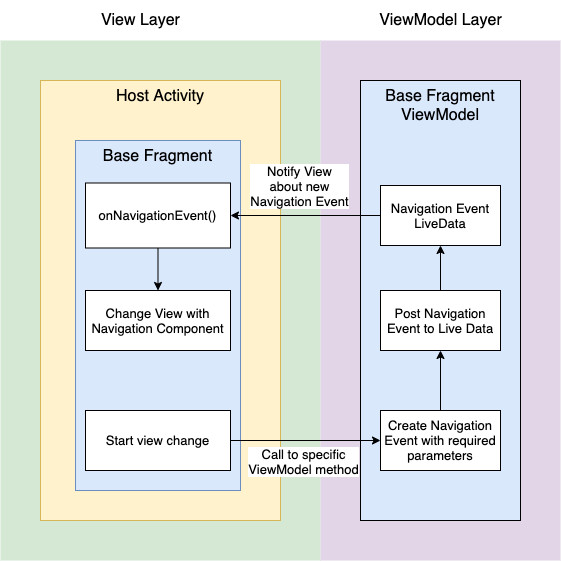

# Agribot Android Application

## Defined gradle wrapper commands
* `./gradlew clean` - Removes build directory with all contents
* `./gradlew dependencyUpdates` - Check all dependencies and lists all possible version updates
* `./gradlew ktlint` - Checks Kotlin files formatting and lists found KTLint style issues
* `./gradlew ktlintFormat` - Reformats code to match KTLint style requirements
* `./gradlew spotlessCheck` - Performs static code analysis with Spotless
* `./gradlew spotlessApply` - Fixes code issues found with Spotless
* `./gradlew publishReleaseBundle` - Builds and pushes Android AAB to `internal` track on Google Play

## Gradle plugins
* [Google Play Publisher](https://github.com/Triple-T/gradle-play-publisher) - Automates release process for Google Play
* [KTLint](https://ktlint.github.io/) - Kotlin linter and formatter
* [Spotless](https://github.com/diffplug/spotless) - Static code analysis tool
* [Versions](https://github.com/ben-manes/gradle-versions-plugin) - Checks dependencies for available updates

## Core libraries
* [Flipper](https://github.com/facebook/flipper) - Advanced debugging tool for mobile applications
* [Koin](https://github.com/InsertKoinIO/koin) - Dependency injection framework for Kotlin & Android
* [MaterialDialogs](https://github.com/afollestad/material-dialogs) - Easy display and management of dialog windows
* [Timber](https://github.com/JakeWharton/timber) - Logging tool, built on top of Android Logger

## Jetpack Components
* [Android Lifecycles](https://developer.android.com/topic/libraries/architecture/lifecycle)
* [Data Binding Library](https://developer.android.com/topic/libraries/data-binding)
* [LiveData](https://developer.android.com/topic/libraries/architecture/livedata)
* [Navigation Component](https://developer.android.com/guide/navigation)
* [ViewModel](https://developer.android.com/topic/libraries/architecture/viewmodel)

## Architecture

### Schematic

### MVVM Patterns
* View Layer consists of `Activity` and `Fragment` classes
* Views can observe ViewModel changes (with `LiveData`), and execute methods provided by ViewModel, but they cannot directly modify ViewModel data or state
* ViewModel notifies View about data changes, by updating `LiveData` observed by View
* ViewModel reference is always attached to layout XML file. More references to variables can be added in each View, by modyfying `<data>` tag inside layout file and `Fragment`/`Activity` `bindViewVariables()` method
* ViewModel methods can be called both from `Fragment`/`Activity`, or from XML layout files
* To ensure View-ViewModel are in the same state, View is not allowed to read ViewModel data directly, but it can observe `LiveData` to receive all required updates

### Activity, Fragment and ViewModel
* `Activity` can be treated as both `Fragment` hosts, and standalone view components
* Each `Activity` has it's own `ViewModel`, which can be shared to child `Fragment` by using `by sharedViewModel()` method instead of `by viewModel()`
* Each `Fragment` can have one or more `ViewModel` objects, all of them can be created with `by viewModel()` method
* `ViewModel` lifecycle is attached directly to lifecycle of parent `Fragment`/`Activity`
* Both `Activity` and `Fragment` use `Data Binding Library`, so their layouts are required to use `<layout>` tag
* `ViewModel` classes should only communicate with Domain Layer classes

### Domain Services and Models
* Domain Layer provides ViewModel Layer acces to Communication Layer methods, with consistent and simplified API. It handles business logic and use cases, as a bridge between View and Communication Layer
* Domain Layer models can be used in View/ViewModel Layer. Communication Layer models should be mapped to Domain Layer models, before they are accessed in View/ViewModel Layers. This behavior secures business logic from Communication Layer API changes
* Domain Layer should not use any platform/library dependent methods, as business logic layer it should not be dependent on Android platform API
* Multiple Domain Layer services can be used in one or more `ViewModel` instances, and they can be injected directly into `ViewModel` constructors.

### Communication Layer and Models
* Communication Layer provides acces to various services, including persistent storage, bluetooth communication, firebase data access, etc.
* Each communication service should implement a proper interface, and should be used behind this interface. This makes handling API/Library changes easier, and secures business logic. As an example, `PersistentStorage` interface is implemented by `SharedPreferencesPersistentStorage`
* Communication Layer models should only be used inside Communication Layer, they should be remapped in Domain Layer.
* Components of Communication Layer can be injected into Domain Layer services constructors

## Navigation

### Schematic

### Navigation Component
* `Activity` requires a `FragmentContainerView` decalred inside it's XML layout file, with `NavHostFragment` class and proper Navigation Graph attached to it.
* Both `BaseActivity` and `BaseFragment` attach Navigation Component and Navigation Event observers on their creation. `Activity` requires to provide ID of view with attached `NavController`, by overriding `open val navigationHostLayoutId: Int?`
* `BaseViewModel` contains `val navigationEvent: NavigationLiveEvent` variable, which is automatically observed by `BaseActivity` and `BaseFragment` subclasses. `BaseViewModel` subclasses can post values to this variable, to notify view about navigation changes.
* `BaseFragment` and `BaseActivity` subclasses can override `open fun handleNavigationEvent(navigationEvent: NavigationEvent)` to handle `NavigationEvent` posted by `BaseViewModel` subclasses

### Navigation Drawer
* Navigation Drawer actions are handled inside `MainActivity`
* Both `AppBar` and `NavigationDrawer` are attached to `NavComponent` using designated methods, `Fragment` changes are handled by it automatically
* All `Fragment` subclasses accessible from Navigation Drawer are declared as top-level destinations inside `MainActivity`, in order to preserve correct back button behaviour
* Navigation Drawer events and view changes can be observed inside `MainActivity`, if required

### Manual Navigation Flow
1. View executes a ViewModel method, that causes View state change
2. Inside ViewModel, a `newNavigationEvent: NavigationEvent` object is created, with a set of parameters required by new View
3. Created `newNavigationEvent` is pushed to `navigationEvent` variable, by calling `navigationEvent.postValue(newNavigationEvent)`
4. Inside View, `handleNavigationEvent(navigationEvent: NavigationEvent)` method is called. In this place, type of event and it's parameters can be checked
5. Depending on type of event, view executes `navController?.navigate()` with desired action defined inside Navigation Graph, and provided parameter set
6. New View is loaded by Navigation Component, with specified parameters

## Build and Deployment

### Building Release AAB
In order to build and sign release, signing files need to be located inside root of project. For security reasons, these files are not stored in version control, and are specified in `.gitignore` to avoid accidential commits. In case a manual, release build is required, place these files in root folder:
* `agribot-android-upload-keystore.jks` - Keystore file used to sign app before upload and resign by Google Play Signing
* `credentials.properties` - Credential file, with required fields:
  * `SIGNING_KEYSTORE_PASSWORD` - Password used to open JKS file
  * `SIGNING_KEY_ALIAS` - Alias for signing key
  * `SIGNING_KEY_PASSWORD` - Password required to read key under specified alias

After these files are located in root project folder, a signed, release build can be generated.

### Deploying to Google Play Store
In order to deploy to Play Store, additional file is required:
* `google_play_api_key.json` - Google Cloud Console service account key

If this file is present in root directory, Google Play deployment can be initiated with `./gradlew publishReleaseBundle --track <track name> --release-name <release name>`. If no argument is specified, track will default to `internal`, and release name will be set to app version.